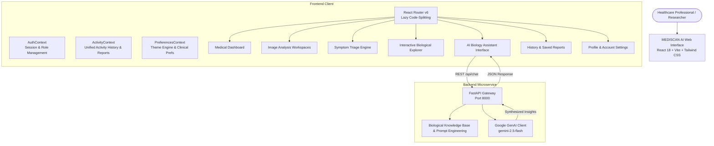

# MEDISCAN AI — Advanced Disease Screening & Biological Analysis Platform

[](https://github.com/)
[](https://react.dev/)
[](https://tailwindcss.com/)
[](https://fastapi.tiangolo.com/)
[](https://ai.google.dev/)
[](LICENSE)

> **IMPORTANT MEDICAL & RESEARCH DISCLAIMER:**  
> **MEDISCAN AI** is an investigational decision-support prototype engineered exclusively for clinical education, medical research, and workflow demonstration. It is **not** a certified medical diagnostic device under FDA 510(k), CE mark, or HIPAA regulatory frameworks. The predictions, triage recommendations, and biological analyses generated by this system must **never** be used as a substitute for professional clinical judgment, pathological confirmation, or emergency medical services.

---

## 🔬 System Overview & Architecture

**MEDISCAN AI** unites computer vision screening workflows, clinical symptom triage engines, interactive human anatomy exploration, and generative AI research assistance into a unified, responsive healthcare SaaS web platform.



---

## 🌟 Key Features Across Completed Phases

### 1. Foundation & Design System (Phase 1)
- **Clinical Color Palette**: Primary Medical Blue (`#2563EB`), Secondary Teal (`#0D9488`), Slate Text (`#0F172A`), Neutral Borders (`#E2E8F0`).
- **Reusable Component Library**: Modals, Dropdowns, Cards, Badges, Tabs, Inputs, Buttons, and Toast notifications.
- **Interactive Design System Showcase**: Visual preview of all core UI components at `/design-system`.

### 2. Authentication & Access Management (Phase 2)
- **Guest & Researcher Sign-In**: Dedicated role profiles with instant demo credentials.
- **Session Persistence**: Secure browser storage with user metadata and role tracking.
- **Route Guards**: `ProtectedRoute` wrapper enforcing unauthenticated redirects to `/login`.

### 3. Medical Dashboard & Analytics (Phase 3)
- **Operational Metrics**: Total scans performed, triage distributions, activity timelines, and system readiness.
- **Interactive Visualizations**: Recharts-powered diagnostic volume breakdown, confidence histograms, and temporal trends.
- **Quick Clinical Shortcuts**: Instant launchpads for image analysis, symptom intake, and biological exploration.

### 4. AI Medical Image Analysis Hub (Phase 4)
- **Three Specialized Screening Pipelines**:
  1. **Dermatological Lesion Screening** (`/image-analysis/skin`): Asymmetry, border irregularity, color variegation, and diameter evaluation.
  2. **Chest Radiograph / Lung Screening** (`/image-analysis/lung`): Consolidation, opacity, and pneumothorax detection simulation.
  3. **Hematological Cytology** (`/image-analysis/blood`): White blood cell differential and morphological anomaly screening.
- **Medical Image Toolbar**: Dual-view comparison, zoom/pan, multi-spectral contrast simulation, and inversion filters.
- **Pre-upload Validation**: Client-side MIME type verification (`image/jpeg`, `image/png`, `image/dicom`) and 25 MB payload checks.

### 5. AI-Assisted Symptom Analysis Workspace (Phase 5)
- **Multi-Stage Clinical Intake**:
  - Step 1: Chief complaint description and duration.
  - Step 2: Interactive body region selector (Head, Chest, Abdomen, Musculoskeletal, Skin, Systemic).
  - Step 3: Associated symptoms, fever tracking, and severity scales.
  - Step 4: Medical history, allergies, and chronic conditions.
- **Red-Flag Detection Engine**: Instant emergency alert triggers for critical cardiovascular, neurological, or respiratory symptoms.
- **Actionable Triage Recommendations**: Emergency, Urgent Care, Routine Outpatient, or Self-Care monitoring pathways.

### 6. Interactive Biological Explorer (Phase 6)
- **Interactive SVG Human Anatomy**: High-precision vector diagram with clickable organ targets and zoom presets.
- **9 Detailed Organ Atlases**: Heart, Lungs, Brain, Liver, Kidneys, Stomach, Pancreas, Spleen, and Intestines.
- **10 Physiological Systems**: Cardiovascular, Respiratory, Nervous, Digestive, Endocrine, Immune, Musculoskeletal, Urinary, Reproductive, Integumentary.
- **6 Molecular & Cellular Processes**: Cellular respiration, protein synthesis, DNA replication, immune response, neural transmission, apoptosis.
- **6 Disease Pathology Case Studies**: Atherosclerosis, COPD, Alzheimer's, Type 2 Diabetes, Glomerulonephritis, Cirrhosis.

### 7. AI Biology Assistant with Google Gemini (Phase 7)
- **FastAPI Microservice**: High-performance asynchronous backend running on `http://127.0.0.1:8000`.
- **Google Gemini 2.5 Flash Integration**: Real-time biological inquiry answering grounded in academic physiology and pathology.
- **Context Injection**: Specialized system prompt enforcing academic precision, clinical disclaimers, and safety boundaries.
- **Graceful Offline Fallback**: Safe 503 response when API credentials are unconfigured, preventing hallucinated medical claims.

### 8. Unified Analysis History & Saved Reports (Phase 8)
- **Centralized Activity Service**: Seamlessly records Image Screenings, Symptom Analyses, and Assistant Inquiries.
- **Interactive Analysis History** (`/analysis-history`): Filterable timeline with search, category filters, and detail drawers.
- **Saved Reports & Medical Export** (`/saved-reports`): Clinical report viewer with one-click printable PDF view and JSON export.

### 9. User Profile & Personalization (Phase 9)
- **Researcher Profile** (`/profile`): User identity, credentials, department affiliation, and clinical activity breakdown.
- **Three-State Theme Engine**: Seamless toggle between Light (`#F8FAFC`), Dark (`#0B0F19`), and System preference.
- **Settings & Data Management** (`/settings`): Notification controls, report preferences, one-click JSON data export, and local cache reset.

### 10. Final System Integration & QA (Phase 10)
- **Full Route Code-Splitting**: `React.lazy` + `Suspense` chunk distribution reducing monolithic bundle size from 1.07 MB to 319 kB vendor chunk.
- **Custom 404 Route**: Branded `NotFoundPage` handling unrecognized paths with quick recovery links.
- **Zero-Error Production Build**: Passes strict Vite compilation with 0 warnings and full asset fingerprinting.

---

## 🛠️ Technology Stack

| Layer | Technologies |
|---|---|
| **Frontend Framework** | React 18, Vite 5, JavaScript (ESNext) |
| **Styling & Icons** | Tailwind CSS 3.4, Lucide React Icons |
| **Animation & Transitions** | Framer Motion |
| **Data Visualization** | Recharts |
| **Backend Microservice** | FastAPI 0.110+, Uvicorn 0.28+, Pydantic v2 |
| **AI / LLM Engine** | Google GenAI SDK (`gemini-2.5-flash`), `google-generativeai` |
| **State & Persistence** | React Context API (`AuthContext`, `ActivityContext`, `PreferencesContext`), Browser `localStorage` |

---

## 🚀 Getting Started

### Prerequisites
- **Node.js**: v18.0.0 or higher
- **npm**: v9.0.0 or higher
- **Python**: v3.10 or higher
- *(Optional)* **Google Gemini API Key**: Obtainable from [Google AI Studio](https://aistudio.google.com/)

---

### Installation & Local Setup

#### 1. Clone & Enter Project Directory
```bash
git clone https://github.com/your-org/mediscan-ai.git
cd "MEDISCAN AI"
```

#### 2. Frontend Setup
```bash
# Install frontend dependencies
npm install

# Start Vite development server (Port 3000)
npm run dev
```
The frontend application will be accessible at: **`http://localhost:3000`**

#### 3. Backend Setup
```bash
# Navigate to the backend directory
cd backend

# Create and activate Python virtual environment
python -m venv venv
# On Windows:
.\venv\Scripts\activate
# On macOS/Linux:
source venv/bin/activate

# Install backend dependencies
pip install -r requirements.txt

# Configure environment variables
copy .env.example .env
# Edit .env and supply your GEMINI_API_KEY
```

#### 4. Run Backend Server
```bash
# From within the backend directory:
uvicorn main:app --host 127.0.0.1 --port 8000 --reload
```
The backend API documentation will be available at: **`http://127.0.0.1:8000/docs`**

---

## 🌐 Application Routing & Navigation Map

| Route Path | Type | Access Level | Description |
|---|---|---|---|
| `/` | Page | Public | Landing page with platform overview, feature cards, and disclaimers |
| `/login` | Page | Public | Researcher authentication with guest demo login |
| `/register` | Page | Public | User onboarding and account registration |
| `/dashboard` | Page | Protected | Main medical dashboard, triage metrics, and operational charts |
| `/image-analysis` | Hub | Protected | Medical image analysis hub with module selector |
| `/image-analysis/skin` | Module | Protected | Dermatological lesion screening interface |
| `/image-analysis/lung` | Module | Protected | Chest radiograph pulmonary screening interface |
| `/image-analysis/blood` | Module | Protected | Hematological cytology blood smear interface |
| `/symptom-analysis` | Page | Protected | 4-step clinical intake and triage recommendation engine |
| `/biological-explorer` | Page | Protected | Interactive SVG human anatomy and physiological systems explorer |
| `/ai-assistant` | Page | Protected | Google Gemini AI biology assistant chat workspace |
| `/analysis-history` | Page | Protected | Filterable timeline of all past scans, intakes, and inquiries |
| `/saved-reports` | Page | Protected | Clinical report archive with print view and PDF export |
| `/profile` | Page | Protected | Researcher credentials, stats, and profile details |
| `/settings` | Page | Protected | Theme preferences, notifications, data export, and cache reset |
| `/design-system` | Page | Protected | Internal UI/UX design token and component showcase |
| `*` | Catch-all | Public | Branded 404 page with navigation recovery actions |

---

## 📡 API Reference

### 1. Health Check
`GET /api/health`
- **Description**: Returns microservice status, active LLM model, and API key configuration status.
- **Response**:
```json
{
  "status": "ok",
  "service": "MEDISCAN AI Biology Assistant API",
  "model": "gemini-2.5-flash",
  "configured": true,
  "message": "Assistant backend ready."
}
```

### 2. Biology Inquiry & Consultation
`POST /api/chat`
- **Headers**: `Content-Type: application/json`
- **Request Body**:
```json
{
  "message": "Explain the role of troponin in myocardial infarction diagnosis.",
  "context": "cardiovascular"
}
```
- **Response**:
```json
{
  "response": "Cardiac troponins (cTnI and cTnT) are regulatory proteins that control the calcium-mediated interaction of actin and myosin...",
  "model": "gemini-2.5-flash",
  "timestamp": "2026-11-12T11:30:00Z",
  "disclaimer": "This information is intended strictly for research and educational purposes."
}
```

---

## 🔒 Security & Privacy Notice

- **Zero Client-Side Secret Exposure**: No Gemini API keys or service credentials are bundled in frontend client code. All LLM calls pass through the backend proxy.
- **Local Data Governance**: All analysis histories, user preferences, and saved reports are stored within browser-controlled `localStorage` and can be completely purged at any time from `/settings`.
- **Strict Git Hygiene**: Secrets, logs, environment files (`.env`, `backend/.env`), and build artifacts are strictly ignored via `.gitignore`.

---

## 📄 License & Attribution

Distributed under the MIT License. Developed for advanced medical research and clinical interface design.
